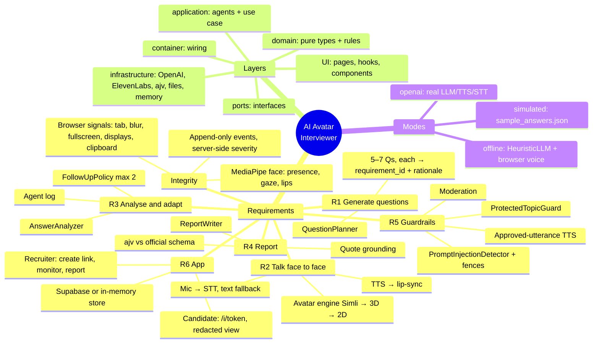
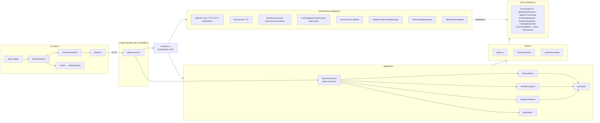
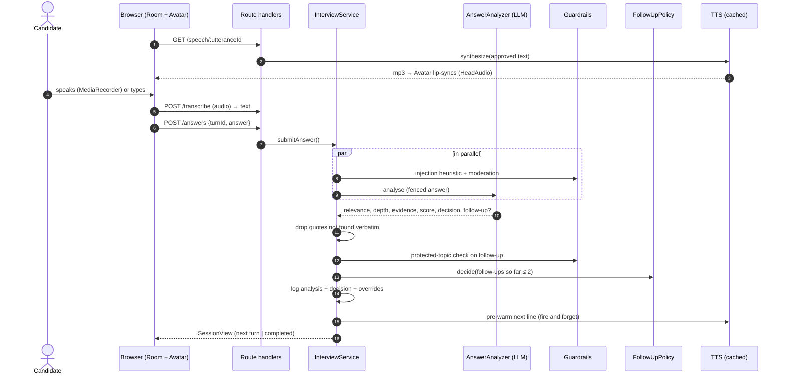
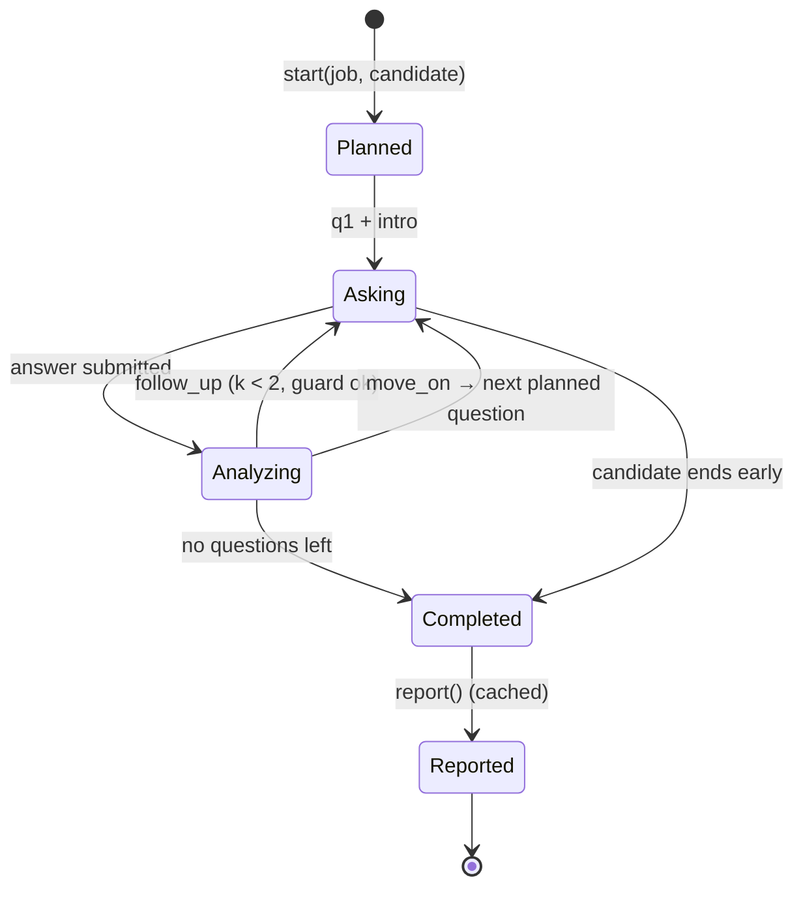
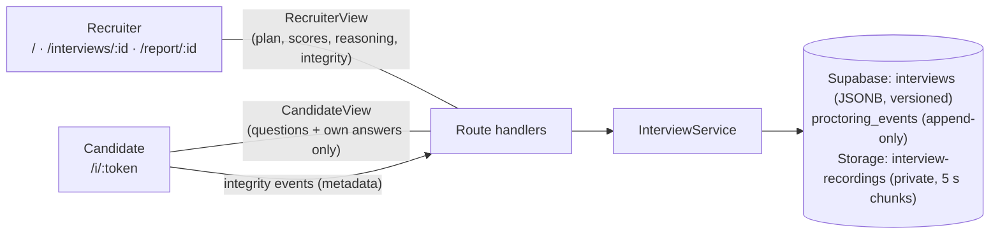

# Mental Map: +twe AI Avatar Interviewer

A one-page map of how the system fits together: what each piece does, which way the dependencies point, and where each requirement in the brief lives. Diagrams are Mermaid, which GitHub renders.

---

## 1. The big picture

---

## 2. Layers and dependency direction (SOLID "D")

Arrows point **toward what a module depends on**. Nothing in `domain/` or `application/` imports a vendor SDK.

---

## 3. One interview turn (sequence)

---

## 4. Interview state machine

---

## 5. Where SOLID shows up

| Principle | Where | What it buys us |
|---|---|---|
| **S**ingle responsibility | `QuestionPlanner`, `AnswerAnalyzer`, `ReportWriter` each do one job. `prompts/` holds only prompt text. `InterviewService` only sequences. `useRecorder`, `useInterviewFlow` and `Avatar` are separate client concerns | Prompts can be tuned without touching control flow. Each piece is testable alone |
| **O**pen/closed | `CachingSpeechSynthesizer` decorates any TTS. New avatar engines implement `AvatarEngine`. New TTS providers (ElevenLabs) are added without editing the service | Features are added by writing new classes, not by editing old ones |
| **L**iskov substitution | `HeuristicLLM` ↔ `OpenAIStructuredLLM`. `simliEngine` ↔ `talkingHeadEngine` ↔ `faceEngine`. `ElevenLabs` ↔ `OpenAI` TTS | Offline mode, tests and fallbacks reuse the exact same flow |
| **I**nterface segregation | Small ports (`SpeechSynthesizer` has 1 method, `ContentModerator` has 1) instead of one "AIProvider" | Adapters implement only what they need |
| **D**ependency inversion | `application/` depends on `ports/`. Only `container.ts` imports concrete classes | Swap OpenAI→other, memory→Postgres in one file |

---

## 6. Guardrail map (defence in depth)

| Threat | Layer 1 (prompt) | Layer 2 (code) | Layer 3 (output) |
|---|---|---|---|
| Protected-topic questions | `ProtectedTopicGuard.promptRule` in planner/analyser prompts | Regex guard on every planned question → repair retry → drop | TTS only speaks **approved utterance ids**, never arbitrary text |
| Hidden instruction in profile (cand_004) | Bio fenced in `<untrusted>` + rule | `PromptInjectionDetector` on bio → session flag + log | Report adds the flag + a concern. Scores capped without evidence |
| Manipulative answers | Answer fenced + "score only genuine content" | Detector + analyser `injection_attempt` → turn flag | Quote grounding: no verbatim evidence means a competency scores ≤ 2 |
| Fabricated evidence | "quotes must be verbatim" | `quoteGrounding` drops quotes not found in the transcript | ajv validation against the official schema |
| Runaway follow-ups | "max 2" in prompt | `FollowUpPolicy` hard cap + logged override | — |
| Toxic content | — | `omni-moderation-latest` (free) | Flag in report |

---

## 7. Who sees what

## 8. File index (where to look)

| Concern | File |
|---|---|
| Domain types | `src/domain/types.ts` |
| Follow-up cap | `src/domain/followUpPolicy.ts` |
| Quote grounding | `src/domain/quoteGrounding.ts` |
| Ports | `src/ports/index.ts` |
| Planner / Analyzer / Writer | `src/application/agents/*.ts` |
| LLM output schemas (zod) | `src/application/agents/schemas.ts` |
| Prompts | `src/application/prompts/index.ts` |
| Guardrails | `src/application/guardrails/*.ts` |
| State machine | `src/application/interviewService.ts` |
| Wiring | `src/container.ts` |
| OpenAI / ElevenLabs adapters | `src/infrastructure/openai/*`, `src/infrastructure/elevenlabs/*` |
| Avatar engines (Simli / TalkingHead / 2D) | `src/components/interview/avatar/*` |
| Avatar session token (keeps the Simli key server-side) | `src/infrastructure/simli/simliSessionIssuer.ts`, `src/app/api/avatar/session/route.ts` |
| Conversation loop (client) | `src/hooks/useInterviewFlow.ts` |
| Simulated run → `/outputs` | `scripts/simulate.ts` |
| Recruiter vs candidate read models | `src/application/views.ts` |
| Integrity rules (domain) | `src/domain/proctoring.ts` |
| Face model + sustained-violation rules | `src/components/interview/proctoring/*` |
| Proctoring hook (browser signals, warnings, batching) | `src/hooks/useProctoring.ts` |
| Supabase repositories + SQL | `src/infrastructure/supabase/*`, `supabase/migrations/*` |
| Interview recording (consent, chunked upload, playback) | `src/domain/recording.ts`, `components/interview/recording/sessionRecorder.ts`, `hooks/useSessionRecording.ts`, `components/recruiter/RecordingPlayer.tsx`, `RecordingStore` port + memory/Supabase adapters |
| Tests | `tests/*.test.ts` |
